# はじめに

このマニュアルは、WordPress用のメール配信プラグイン「メール侍（Mail Samurai）」v1.6.0 の使い方をまとめたものです。インストールから最初の1通を届けるまでの手順と、メルマガの送り方、購読者の管理、困ったときの確認先までを順番に説明します。

- 対象バージョン：v1.6.0
- 開発：三浦アンジン（ecさむらい）
- 配布元：https://github.com/ecsamurai/mail-samurai
- ライセンス：GPLv2 or later（無料で利用・改変できます）

画面の名前やボタンの文言は、v1.6.0 の管理画面の表記に合わせています。画面例は検証用のWordPressで撮影したもので、メールアドレスや数値はすべて架空のものです。

## 急いで始めたい方へ

最初の1通を届けるまでは、次の順に読み進めてください。

1. 第1章「メール侍でできることと、導入前の準備」
2. 第2章「インストールと旧版からの更新」
3. 第3章「最初の1通を届けるまで」
4. 第4章「登録フォーム」

すでに旧版を使っていて、v1.6.0 の新機能だけ知りたい場合は、第2章の「旧版からの更新」と第6章「購読者の管理と行動履歴」を読んでください。

# メール侍でできることと、導入前の準備

## メール侍でできること

メール侍は、WordPressだけで動くメール配信プラグインです。外部の配信サービスに登録せず、あなたのWordPressとサーバーからメールを送ります。

| 機能 | 内容 | 管理画面 |
|---|---|---|
| ステップメール | 登録した日を起点に、決めた順番・タイミングで自動配信 | シーケンス |
| 登録フォーム | 画面で作ったショートコードをページに貼るだけで設置 | 登録フォーム |
| メルマガ（単発メール） | 購読中の人全員に、お知らせを1回だけ送る | メルマガ |
| 購読者の管理 | 一覧・検索・絞り込み、一人ごとの行動履歴、手動での配信停止 | 購読者 |
| 成果の確認 | 開封率・クリック率・解除率と、成績が落ちたステップの警告 | ダッシュボード |
| 配信解除リンク | 送信者情報と配信解除リンクを、すべてのメールの末尾に自動で挿入 | （自動） |

有効化すると、管理画面の左メニューに「メール侍」が追加されます。中には「ダッシュボード」「シーケンス」「登録フォーム」「購読者」「メルマガ」「設定」の6つの画面があります。

## ステップメールと単発メルマガの違い

メール侍では、2種類のメールを送れます。

| | ステップメール | メルマガ（単発メール） |
|---|---|---|
| 送るタイミング | 一人ひとりの登録日から「○日後」に自動で | 送信ボタンを押したときに1回だけ |
| 届く内容 | 登録した日が違えば、同じ日に届くメールも人によって違う | 全員に同じ内容 |
| 向いている使い方 | お礼・特典の案内、教育的な連続メール、商品案内 | お知らせ、新商品、イベント告知 |
| 作る画面 | シーケンス | メルマガ |

## シーケンスとステップ

ステップメールのまとまりを「**シーケンス**」、その中の1通1通を「**ステップ**」と呼びます。例えば「無料メール講座」というシーケンスの中に、「登録直後のお礼」「翌日の1通目」「3日後の2通目」というステップを並べます。

- 登録フォームは、どのシーケンスに登録させるかを決めて設置します。
- 同じメールアドレスでも、シーケンスが違えば別々に登録されます。
- メルマガは「どのシーケンスの購読者に送るか」を選んで送ります。メルマガ画面では、シーケンスを「配信リスト」と表示しています。

有効化すると、最初のシーケンス「メイン配信」が自動で作られます。中身（ステップ）は空なので、第3章でステップを追加します。

## 動作環境

| 項目 | 必要なもの |
|---|---|
| WordPress | 6.x |
| PHP | 7.4 以上 |
| メール送信 | WordPressからメールが届く状態（SMTPプラグインの設定を推奨） |
| 定期処理 | WP-Cron（標準）。時刻どおりに送りたい場合はサーバーcronを推奨（第3章） |

## メール侍と送信プラグインの役割分担

メール侍は「誰に・いつ・何を送るか」を管理します。メールを実際に送り出す仕組み（**SMTP**：メールを送信サーバー経由で送るための仕組み）は持っていません。

送信には、WordPress標準の送信機能を使います。多くのサーバーでは、標準のままだと迷惑メール扱いされやすいため、**WP Mail SMTP** や **FluentSMTP** などの送信プラグインで、サーバー会社や送信サービスのSMTPを設定しておくことをおすすめします。

| 担当 | 役割 |
|---|---|
| メール侍 | 購読者の管理、配信の予約と順番、本文の加工（差し込み・計測・解除リンク） |
| 送信プラグイン（WP Mail SMTPなど） | SMTPサーバーへの接続と、実際の送信 |
| サーバー・送信サービス | メールの配送、送信数の上限 |

送信サービスを乗り換えるときは、送信プラグイン側の設定を変えるだけで済みます。メール侍の設定は変わりません。

## 費用について

メール侍の本体は無料です。購読者が何人になっても、プラグインの費用はかかりません。

ただし、次の費用は別にかかります。

- WordPressを動かすサーバーの費用
- 独自ドメインの費用
- 送信サービス（SendGridなど）を使う場合は、その利用料
- 送信プラグインの有料版を使う場合は、その利用料

1時間あたりに送れる通数の上限も、サーバーや送信サービスの契約で決まります。

## 向いている規模

購読者数の上限はありません。バウンス（届かなかったメール）を手動で処理する前提のため、数百件程度までが無理なく運用できる目安です。

送信量は、メール侍の設定画面の「バッチサイズ」と、サーバー・送信サービスの送信上限で決まります。バウンスの扱いは第8章で説明します。

# インストールと旧版からの更新

## 配布ZIPを入手する

メール侍は、GitHubの正式リリースから配布ZIPをダウンロードして入れます。WordPress公式のプラグイン一覧にはまだ登録していないため、管理画面の検索では見つかりません。

1. 配布ページ https://github.com/ecsamurai/mail-samurai/releases/tag/v1.6.0 を開きます。
2. ページ下部の「**Assets**」から `mail-samurai-1.6.0.zip` をダウンロードします。
3. ZIPは解凍せず、そのまま使います。

> **注意**
> 「Assets」に自動で並ぶ「Source code (zip)」は使わないでください。中のフォルダ名が違うため、WordPressに入れると別のプラグインとして扱われます。必ず `mail-samurai-1.6.0.zip` を選んでください。

## 新しくインストールする

1. WordPressの管理画面で「プラグイン → 新規追加 → プラグインのアップロード」を開きます。
2. 「ファイルを選択」で `mail-samurai-1.6.0.zip` を選び、「今すぐインストール」を押します。
3. 「プラグインを有効化」を押します。

有効化すると、次の状態になります。

| 項目 | 初期状態 |
|---|---|
| 左メニュー | 「メール侍」が追加される |
| シーケンス | 「メイン配信」が1つ作られる（ステップは空） |
| 送信元名 | サイトのタイトル |
| 送信元アドレス | WordPressの管理者メールアドレス |
| バッチサイズ | 50通 / 5分 |
| 開封・クリックの計測 | どちらもON |
| 行動履歴の保存期間 | 365日 |

## 旧版からの更新

旧版（v1.5.1 以前）を使っている場合は、新しいZIPをアップロードして置き換えます。

1. 「プラグイン → 新規追加 → プラグインのアップロード」で `mail-samurai-1.6.0.zip` を選び、「今すぐインストール」を押します。
2. 「プラグインはすでにインストールされています」という画面で「**現在のものをアップロードしたもので置き換える**」を押します。
3. 完了画面が出たら更新は終わりです。プラグイン一覧でバージョンが 1.6.0 になっていることを確認してください。

> **注意：更新のためにプラグインを「削除」しないでください**
> プラグイン一覧で「削除」を押すと、購読者・ステップ・配信記録・行動履歴・設定など、メール侍のデータがすべて消えます（アンインストール時の仕様です）。一度消えたデータは元に戻せません。「無効化」だけならデータは消えません。

### v1.6.0 に更新したときに起きること

- 更新後、最初にWordPressが読み込まれたときに、行動履歴を保存するための新しいテーブル（データの保存場所）が自動で追加されます。
- 購読者・シーケンス・ステップ・配信記録・メルマガ・設定などの既存データは、そのまま残ります。
- 行動履歴は、更新した後の行動から記録が始まります。更新前の繰り返しの開封やクリック、誰が解除したかといった情報は、さかのぼって作られません。
- 行動履歴の保存期間は、初期値の365日に設定されます。

# 最初の1通を届けるまで

ここでは、実際の画面の順に沿って「登録した人にお礼メールが届く」状態を作ります。

## 1. SMTPを設定し、受信を確認する

メール侍を設定する前に、WordPressからメールが確実に届く状態にしておきます。

1. 「プラグイン → 新規追加」で WP Mail SMTP や FluentSMTP などの送信プラグインを入れます。
2. サーバー会社や送信サービスから案内されている SMTP の情報（ホスト・ポート・ユーザー名・パスワード）を入力します。値は契約先のマニュアルで確認してください。
3. 送信プラグインのテスト送信で、自分のアドレスにメールが届くことを確認します。

### 送信ドメインの認証（SPF・DKIM・DMARC）

差出人には、独自ドメインのアドレス（例：info@あなたのドメイン）を使い、そのドメインに次の3つを設定してください。設定がないと、Gmailなどでは迷惑メールに入りやすく、届かないこともあります。

| 名前 | 意味 |
|---|---|
| SPF | 「このドメインのメールは、このサーバーから送る」という宣言 |
| DKIM | メールに電子署名を付け、途中で書き換えられていないことを示す仕組み |
| DMARC | SPF・DKIMの確認に失敗したメールを、受信側がどう扱うかの方針 |

設定方法はサーバー会社ごとに異なります。各社の公式マニュアルに沿って設定してください。Gmailで受信したメールの「メッセージのソースを表示」で、SPF・DKIM・DMARC が「PASS」になっていれば設定できています。

## 2. メール侍の差出人と送信設定

「メール侍 → 設定」を開きます。

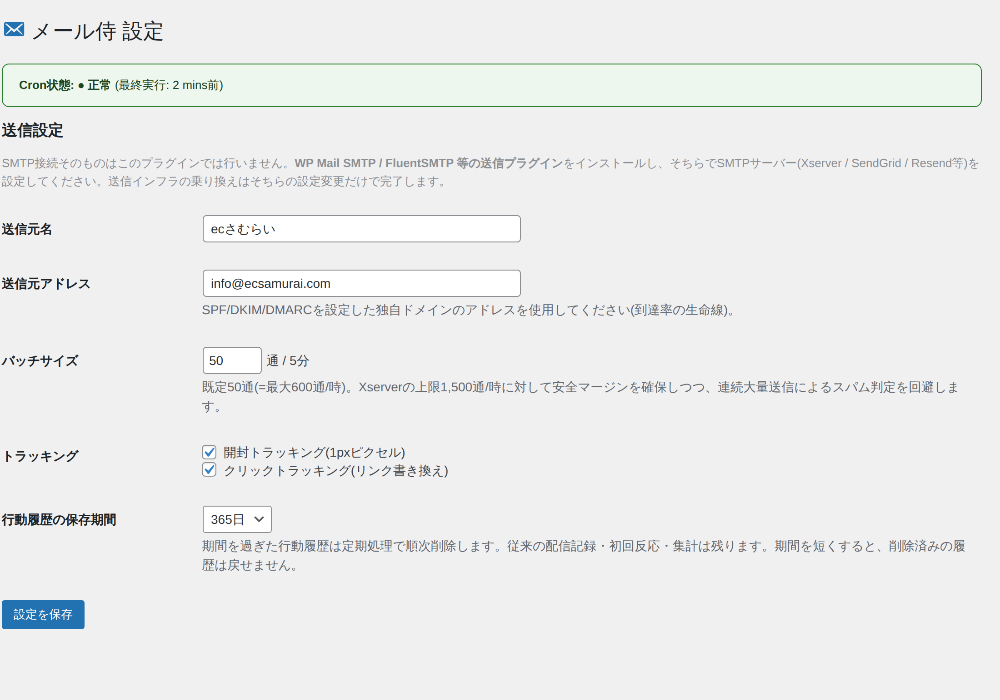

| 項目 | 内容 |
|---|---|
| 送信元名 | 受信者に表示される差出人名（お店や個人の名前） |
| 送信元アドレス | 差出人のアドレス。SPF・DKIM・DMARC を設定した独自ドメインのもの |
| バッチサイズ | 5分ごとに送る最大通数（1〜500通、初期値50通＝1時間に最大600通）。サーバーや送信サービスの上限より少なくします |
| トラッキング | 開封トラッキング（1pxピクセル）と、クリックトラッキング（リンク書き換え）のON・OFF |
| 行動履歴の保存期間 | 90日・180日・365日・無期限から選択（初期値365日）。第6章で説明します |

入力したら「設定を保存」を押します。

送信プラグインに「差出人を固定する」設定がある場合は、そちらが優先されることがあります。テスト送信で、受信したメールの差出人を確認してください。

### Cron状態と直近の送信エラー

画面の一番上には「**Cron状態**」が表示されます。

- 「● 正常」：配信の処理（5分ごと）が最近15分以内に動いています。
- 「● 停止の可能性」：処理がしばらく動いていません。下の「サーバーcron」を確認してください。

送信に失敗したことがある場合は、「**直近の送信エラー**」として、送信プラグインから受け取ったエラーの内容が表示されます。

### WP-Cronとサーバーcron

メール侍は、5分ごとに送信待ちのメールを順番に送ります。この定期処理には、WordPress標準の「**WP-Cron**」を使います。

- **WP-Cron**：サイトに誰かがアクセスしたときに動く仕組みです。アクセスの少ない深夜などは、配信が遅れることがあります。
- **サーバーcron**：サーバーが決まった時刻に処理を実行する仕組みです。アクセスがなくても時刻どおりに動きます。

時刻どおりに届けたい場合は、サーバーcronの設定をおすすめします。設定が済んでいないあいだは、設定画面に手順と、あなたのサーバーのフォルダ名入りのコマンドが表示されます。

1. `wp-config.php` に `define( 'DISABLE_WP_CRON', true );` を追加します。
2. サーバーの管理画面の cron 設定で、設定画面に表示されたコマンドを5分おきに実行するよう登録します。

設定が済むと、設定画面に「DISABLE_WP_CRON 設定済み」と表示されます。cron の登録方法や最短の実行間隔はサーバー会社ごとに違うため、契約先の案内に従ってください。

## 3. シーケンスを用意する

「メール侍 → シーケンス」を開きます。最初は「メイン配信」が選ばれています。

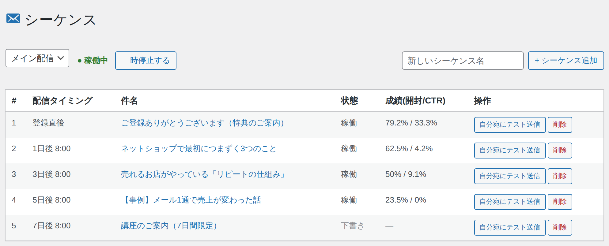

- 別のシーケンスを作るときは、右上の「新しいシーケンス名」に名前を入れて「＋シーケンス追加」を押します。
- 左上のプルダウンで、編集するシーケンスを切り替えます。
- 「一時停止する」を押すと、そのシーケンスのステップメールの配信が止まります（新規登録は受け付けます）。「稼働させる」で再開します。
- ステップが1つもないシーケンスだけ、「このシーケンスを削除」で削除できます。

## 4. ステップを作る

画面下の「＋ステップを追加」で、1通分のメールを作ります。

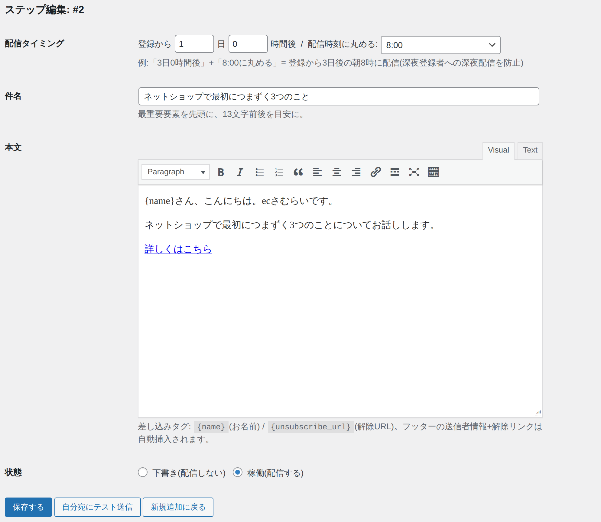

| 項目 | 内容 |
|---|---|
| 配信タイミング | 「登録から ○日 ○時間後」（0〜365日、0〜23時間）と「配信時刻に丸める」 |
| 件名 | メールの件名。画面には「最重要要素を先頭に、13文字前後を目安に」と案内されています |
| 本文 | 投稿と同じエディタで書けます。リンクや太字も使えます |
| 状態 | 「下書き（配信しない）」または「稼働（配信する）」 |

入力したら「ステップを追加する」を押します。作ったステップは一覧の件名を押すと編集でき、編集画面では「保存する」で上書きします。

### 配信タイミングの決め方

配信日時は、**登録した日時**を起点に計算します。前のステップからの間隔ではありません。

「配信時刻に丸める」で時刻を選ぶと、「登録から○日○時間後」の日の、その時刻に送ります。「丸めない（オフセット通り）」を選ぶと、計算どおりの時刻に送ります。

| やりたいこと | 登録から | 配信時刻に丸める |
|---|---|---|
| 登録した直後にお礼メール | 0日 0時間後 | 丸めない（オフセット通り） |
| 翌日の朝8時 | 1日 0時間後 | 8:00 |
| 3日後の朝8時 | 3日 0時間後 | 8:00 |
| 登録からちょうど6時間後 | 0日 6時間後 | 丸めない（オフセット通り） |

「0日 0時間後」に「8:00」を組み合わせると、登録後に最初に来る朝8時に送ります。

### 深夜に登録した人の例

月曜の22時に登録した人には、次のように届きます。

| ステップ | 設定 | 届く日時 |
|---|---|---|
| 1通目 | 0日 0時間後・丸めない | 月曜 22時（登録直後） |
| 2通目 | 1日 0時間後・8:00 | 火曜 朝8時 |
| 3通目 | 3日 0時間後・8:00 | 木曜 朝8時 |

「○日後の○時」は、登録した日を0日目として数えます。そのため、夜に登録した人は、1通目と2通目の間隔が短くなります（この例では約10時間）。配信時刻をそろえると、夜中にメールが届くことを防げます。

### 下書きと稼働の違い

| 状態 | 動き |
|---|---|
| 下書き（配信しない） | 送られません。新しく作るステップの初期値です |
| 稼働（配信する） | 予定の日時が来た人から送られます |

知っておきたい動きをまとめます。

- あとからステップを追加すると、すでに登録している人のうち、予定日がまだ来ていない人には届きます。予定日を過ぎていた人には送られません。
- 下書きのステップを稼働に切り替えると、予定日を過ぎている人にも次の配信処理でまとめて送られます。
- 配信中のステップのタイミングを変えると、まだ送っていない分の予定が組み直されます。組み直した結果、予定日を過ぎた分は次の配信処理で送られます。
- ステップを削除すると、まだ送っていない予定だけが消えます。送信済みの記録は残ります。

まとめて送りたくない場合は、いったん「下書き」に戻してから変更し、予定を確認してから「稼働」に戻してください。

### 登録直後のお礼メール

1通目は、次の設定で作るのが基本です。

- 配信タイミング：**0日 0時間後・丸めない（オフセット通り）**
- 状態：**稼働（配信する）**

この設定のステップがあると、登録フォームから登録した直後に、その人の1通目がすぐ送られます。お礼や特典の案内は、この1通目に入れます。

### 差し込みタグ

本文には次のタグを書けます。

| タグ | 置き換わる内容 |
|---|---|
| `{name}` | 登録時に入力されたお名前。お名前がない場合は「あなた」になります |
| `{unsubscribe_url}` | その人専用の配信解除URL |

送信者情報（送信元名とアドレス）と配信解除リンクは、タグを書かなくても、すべてのメールの末尾に自動で入ります。本文に `{unsubscribe_url}` がないまま保存すると、本文内にも入れることをすすめる注意が表示されます。

## 5. テスト送信で確認する

ステップ一覧の「**自分宛にテスト送信**」を押すと、ログイン中のWordPressユーザーのメールアドレスに、そのステップが届きます（ステップの編集画面にも同じボタンがあります）。

受信したら、次の点を確認してください。

- 差出人の名前とアドレスが正しいか
- 件名の頭に【テスト】が付いているか（テスト送信の目印です）
- 本文の見た目、改行、`{name}` の置き換え（テストでは「テスト太郎」になります）
- 本文内のリンクが、正しいページに開くか
- 末尾に送信者情報と配信解除リンクが入っているか
- 迷惑メールフォルダに入っていないか

テスト送信では、開封やクリックを計測しません。リンクは本来のページにそのまま飛びます。テストメールの解除リンクを押すと「テスト送信の解除リンクです」というページが表示され、誰の配信も停止されません。

送信に失敗した場合は、画面に失敗の通知と、取得できたエラーの内容が表示されます。

## 6. 登録フォームを設置する

「メール侍 → 登録フォーム」でショートコードを作り、固定ページに貼ります。詳しい手順は第4章で説明します。

## 7. 自分のアドレスで、登録から解除まで確認する

フォームを公開したら、実際に自分のアドレスで一通り試します。

1. フォームを置いたページを開き、自分のメールアドレスで登録します。
2. 画面に「ご登録ありがとうございます!」と表示され、1通目のメールがすぐ届くことを確認します。
3. 届いたメールを開き、本文内のリンクを1つ押します。
4. 「メール侍 → 購読者」で自分のメールアドレスを押し、詳細画面の「行動履歴」に「登録」「送信処理成功」「開封を検知」「リンクをクリック」が並んでいることを確認します（開封はメールアプリの画像表示の設定によっては記録されません）。
5. メール末尾の「こちら（配信解除）」を押し、「配信を解除しました」と表示されることを確認します。
6. 購読者の詳細画面で、状態が「解除済み」、行動履歴に「本人による登録解除」が記録されていることを確認します。

確認のあと、同じアドレスで再びフォームから登録すると、購読中に戻ります（「再登録」として記録されます）。配信の予定は最初からやり直しにはならず、予定日がまだ来ていないステップから再び届きます。

# 登録フォーム

## ショートコードを作る

ショートコードとは、`[mailsamurai_form ...]` のように角かっこで書く短いコードです。WordPressのページに貼ると、その場所に登録フォームが表示されます。

「メール侍 → 登録フォーム」を開きます。

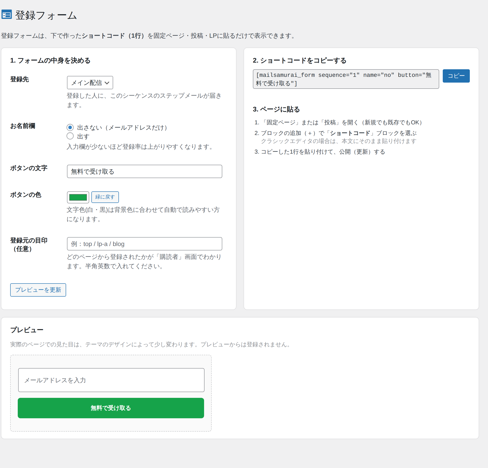

画面は3つの手順に分かれています。

1. **フォームの中身を決める**：項目を選ぶと、右のショートコードとプレビューがその場で変わります。
2. **ショートコードをコピーする**：「コピー」ボタンを押します。
3. **ページに貼る**：次の節の手順で貼り付けます。

| 項目 | 内容 | ショートコードでの書き方 |
|---|---|---|
| 登録先 | 登録した人に届くシーケンス | `sequence="1"` |
| お名前欄 | 「出さない（メールアドレスだけ）」か「出す」 | 出さない場合 `name="no"` |
| ボタンの文字 | ボタンに表示する言葉（画面の初期値は「無料で受け取る」） | `button="無料で受け取る"` |
| ボタンの色 | 標準は緑。「緑に戻す」で標準色に戻せます。文字色（白・黒）は背景色に合わせて自動で読みやすい方になります | `color="#16a34a"` |
| 登録元の目印（任意） | どのページから登録されたかを見分けるための目印。半角英数（と `-` `_`） | `source="lp-a"` |

例：`[mailsamurai_form sequence="1" name="no" button="無料で受け取る" source="lp-a"]`

登録元の目印は、購読者一覧の「流入元」に表示されます。トップページは `top`、LPは `lp-a` のように、ページごとに変えておくと便利です。

画面下のプレビューは見た目の確認用です。プレビューから登録はされません。

## WordPressのページに貼る

1. 「固定ページ」または「投稿」を開きます（新規でも既存でも構いません）。
2. ブロックの追加（＋）で「**ショートコード**」ブロックを選びます。クラシックエディタの場合は、本文にそのまま貼り付けます。
3. コピーした1行を貼り付けて、公開（更新）します。

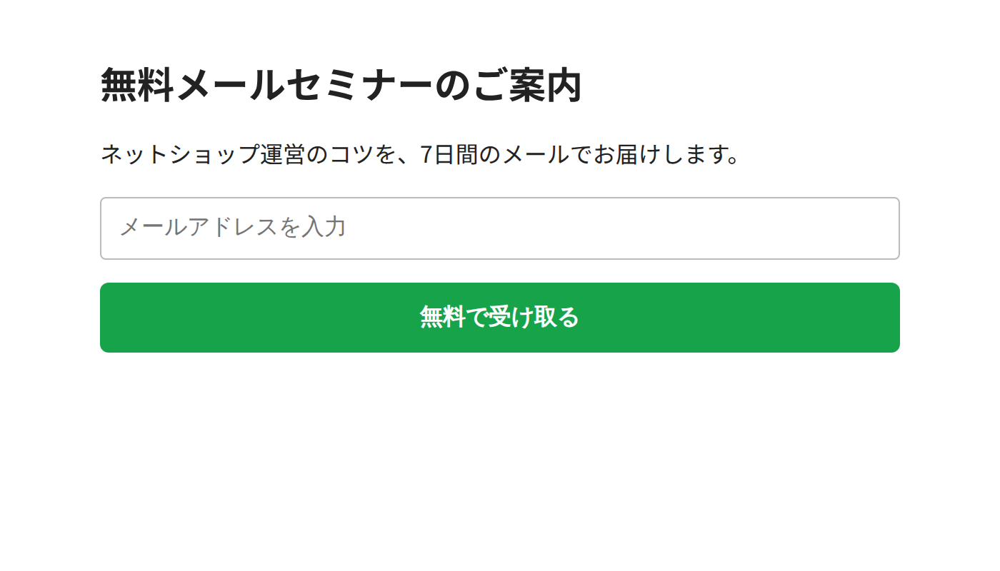

> **注意**
> ショートコードは、WordPressのページの中でだけフォームに変わります。HTMLファイルをパソコンで直接開いたり、WordPress以外のページに貼ったりしても、`[mailsamurai_form ...]` の文字がそのまま表示されるだけで動きません。

## 登録したときの動き

- 登録すると、同じページに戻り「ご登録ありがとうございます!メールをお送りしますので、受信箱をご確認ください。」と表示されます。
- 「0日 0時間後・丸めない・稼働」のステップがあれば、その場で1通目が送られます。
- すでに購読中のアドレスで登録すると「すでにご登録いただいています。」と表示され、配信の予定は変わりません。
- メールアドレスの形式が正しくない場合などは「登録に失敗しました。メールアドレスをご確認のうえ、もう一度お試しください。」と表示されます。
- ロボットによるいたずら登録は、人には見えない入力欄（ハニーポット）で防いでいます。

## 登録直後のステップがないときの警告

選んだ登録先に、登録直後に届くステップ（0日 0時間後・丸めない・稼働）がないと、登録フォーム画面に次の警告が表示されます。

「このシーケンスには『登録直後』に届くステップがまだありません。」

このままでは、登録しても最初のメールがすぐには届きません。「シーケンスを開く」から、該当するステップを1通作ってください。

# メルマガ（単発メール）を送る

「メール侍 → メルマガ」では、選んだシーケンスの購読中の人全員に、お知らせを1回だけ送れます。

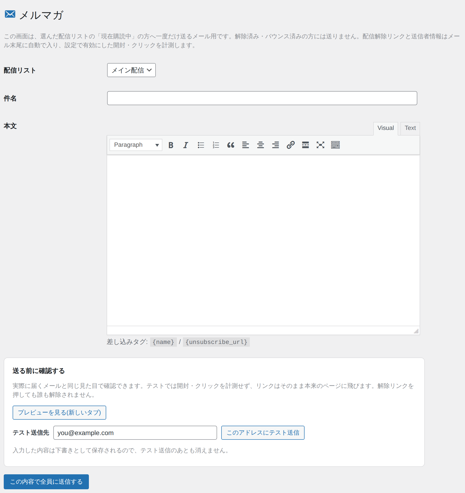

## 配信の対象

- 「配信リスト」で選んだシーケンスに登録している、**状態が「購読中」の人**が対象です。
- 解除済みの人や、バウンス扱いの人には送られません。
- 送信を始めたあとに解除した人の分は、まだ送っていなければ送られずに飛ばされます。

## 件名・本文・差し込みタグ

ステップメールと同じく、件名と本文を入力します。本文には `{name}` と `{unsubscribe_url}` が使え、送信者情報と配信解除リンクは末尾に自動で入ります。

## 送る前に確認する

本配信の前に、「送る前に確認する」の欄で、自分だけに届けて確かめられます。

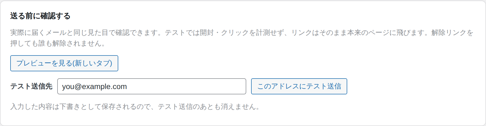

| ボタン | できること |
|---|---|
| プレビューを見る（新しいタブ） | 実際に届くメールと同じ見た目を、ブラウザの新しいタブで表示します |
| このアドレスにテスト送信 | 「テスト送信先」に入力したアドレスにだけ1通送ります。アドレスは次回のために記憶されます |

- テストメールの件名には【テスト】が付きます。
- テストでは開封・クリックを計測しません。リンクは本来のページにそのまま飛びます。
- テストメールの解除リンクは、実際の購読者を解除しません。押すと「テスト送信の解除リンクです」と表示されます。
- プレビューやテスト送信を押すと、入力中の内容が下書きとして保存されます。画面に戻っても入力は消えません。本配信を作ると、下書きは消えます。

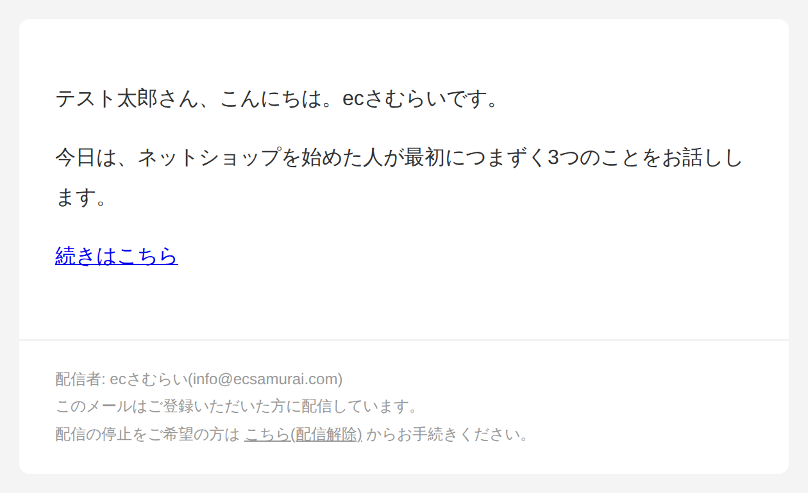

## 本配信と送信のしくみ

確認できたら「**この内容で全員に送信する**」を押します。確認のダイアログで「OK」を押すと、配信対象の全員分の送信予約（キュー）が作られます。

**キュー**とは、送信待ちのメールの行列のことです。メルマガはその場で一斉に送られるのではなく、5分ごとの配信処理で、バッチサイズの範囲内で少しずつ送られます。ステップメールと同じ枠を共有するため、ステップメールとメルマガを合わせて、1回あたりバッチサイズの通数までになります。

例：バッチサイズ50通のとき、1,000人へのメルマガはおよそ1時間40分で送り終わります（ステップメールの送信が少ない場合）。

## 送信状況と成果の読み方

画面下の「最近のメルマガ」で、送ったメルマガの状況を確認できます。

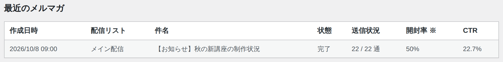

| 列 | 意味 |
|---|---|
| 状態 | 「送信待ち」：まだ送っていない分がある／「完了」：すべて送り終わった |
| 送信状況 | 送信できた通数 / 配信対象の通数。失敗があれば「（失敗 ○）」 |
| 開封率 ※ | 送った通数のうち、開封を検知したメールの割合 |
| CTR | クリック率。送った通数のうち、リンクがクリックされたメールの割合 |

開封率は、メールアプリが画像を自動で読み込むと高めに出ることがあります。リンクを含むメルマガは、クリック率もあわせて判断してください。

# 購読者の管理と行動履歴（v1.6.0）

## 購読者一覧

「メール侍 → 購読者」で、登録した人の一覧を確認できます。

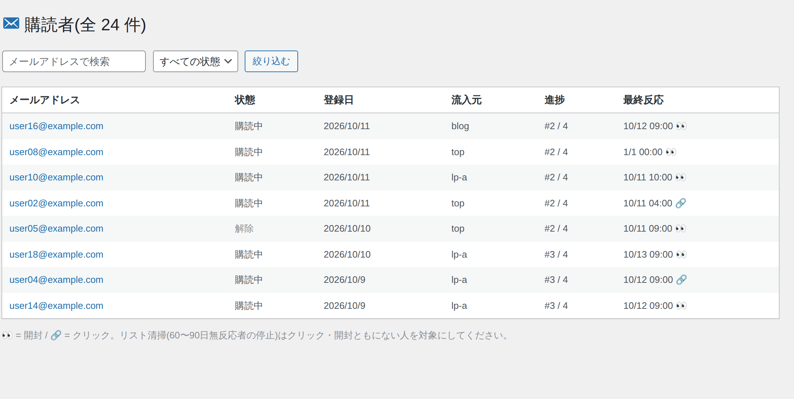

| 列 | 内容 |
|---|---|
| メールアドレス | 押すと、その人の詳細画面が開きます |
| 状態 | 購読中／解除／バウンス |
| 登録日 | 登録した日 |
| 流入元 | 登録フォームに付けた「登録元の目印」 |
| 進捗 | そのシーケンスのステップを何通まで送ったか |
| 最終反応 | 最後に開封（👀）またはクリック（🔗）した日時 |

上の検索欄でメールアドレスを検索したり、状態で絞り込んだりできます。一覧は50件ごとに表示されます。

## 購読者の詳細画面

操作の入口：**メール侍 → 購読者 → メールアドレスをクリック**

詳細画面には、上から次の情報が並びます。

1. 状態・お名前・流入元・登録日時
2. **行動履歴**（v1.6.0 で追加）
3. **配信記録・初回反応**（以前からある記録）
4. 「このアドレスを配信停止する」ボタン（購読中の場合のみ）

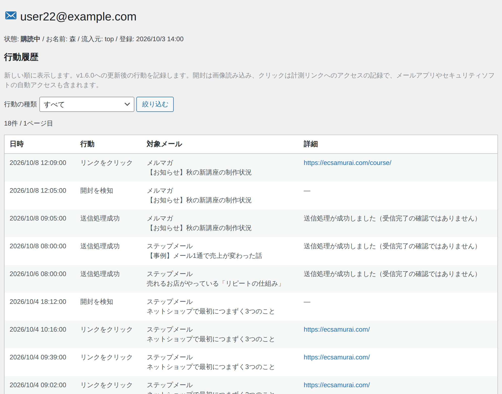

## 行動履歴に記録される内容

行動履歴は、その人に起きた出来事を1件ずつ記録したものです。同じ人が同じメールを何回開いても、何回クリックしても、その都度1件として残ります。

| 行動の種類（画面の表示） | 記録されるとき | 「対象メール」「詳細」欄 |
|---|---|---|
| 登録 | 登録フォームから新しく登録したとき | — |
| 再登録 | 解除済みの人が、もう一度フォームから登録したとき | — |
| 送信処理成功 | ステップメール・メルマガの送信処理が成功したとき | 種類と件名／「送信処理が成功しました（受信完了の確認ではありません）」 |
| 送信失敗（再試行終了） | 送信に失敗し、最大3回の試行がすべて失敗したとき | 種類と件名 |
| 開封を検知 | メール内の計測用画像が読み込まれるたび | 種類と件名 |
| リンクをクリック | 計測用リンクが開かれるたび（同じリンクの再クリックも含む） | 種類と件名／クリック先のURL |
| 本人による登録解除 | 本人がメールの解除リンクから解除したとき | — |
| 管理者による配信停止 | 管理者が「このアドレスを配信停止する」を押したとき | 操作した管理者の表示名 |

「対象メール」欄には、ステップメールかメルマガかの区別と、そのメールの件名が表示されます。

## 表示・絞り込み・ページ送り

- 行動履歴は**新しい順**に表示されます。
- 「行動の種類」で種類を選んで「絞り込む」を押すと、その種類だけを表示できます（例：「リンクをクリック」だけ）。
- 1ページに**50件**ずつ表示されます。件数が多いときは「次のページ →」「← 前のページ」で移動します。表の上に「○件 / ○ページ目」と表示されます。

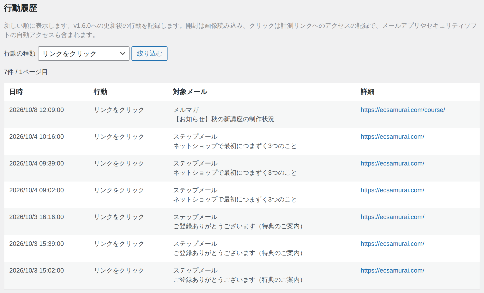

## 行動履歴と「配信記録・初回反応」の違い

詳細画面の下にある「配信記録・初回反応」は、以前からある記録です。

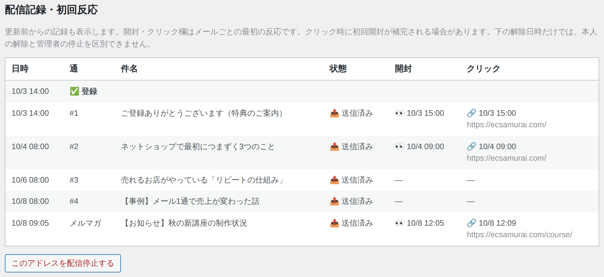

メール1通ごとに1行で、その通の送信状態と、**最初の**開封日時・**最初の**クリック日時だけを記録します。ダッシュボードやメルマガ画面の開封率・クリック率は、この記録をもとに計算しています。

| | 行動履歴（v1.6.0〜） | 配信記録・初回反応 |
|---|---|---|
| 単位 | 出来事1件ごと | メール1通ごとに1行 |
| 開封・クリック | 毎回記録 | 最初の1回だけ |
| 解除の区別 | 本人の解除と管理者の停止を区別 | 解除日時のみ（区別できない） |
| 記録の範囲 | v1.6.0 に更新した後の行動 | 更新前からの記録も表示 |
| 保存期間 | 設定した期間を過ぎると削除 | 期間による削除はなし |
| 使われ方 | 一人ひとりの動きを詳しく見る | 開封率・クリック率などの集計 |

### 具体例：同じリンクを3回クリックした場合

ある人が、同じメールの同じリンクを3回クリックしたとします。

- **行動履歴**には「リンクをクリック」が3件残ります。それぞれのクリック日時とクリック先が分かります。
- **配信記録・初回反応**では、その通のクリック欄に最初のクリック日時が1つ入るだけです。
- そのため、クリック率では、この人は「クリックした1人（1通）」として数えられます。3人分として数えられることはありません。

## 行動履歴を読むときの注意

- **更新前の情報は復元できません。** v1.6.0 に更新する前の、繰り返しの開封やクリック、誰が解除したか（本人か管理者か）は記録されていないため、行動履歴には出ません。更新前の情報は「配信記録・初回反応」で確認してください。
- **初回開封の補完と、実際の開封は別です。** 以前からの集計では、クリックがあった通は「開封もした」とみなして、初回開封の日時を補います。一方、行動履歴の「開封を検知」は、計測用画像が実際に読み込まれたときだけ記録されます。クリックだけがあった場合、配信記録には開封日時が入りますが、行動履歴に「開封を検知」は追加されません。
- **自動のアクセスも含まれます。** 開封は計測用画像の読み込み、クリックは計測用リンクへのアクセスの記録です。メールアプリの画像の自動読み込みや、セキュリティソフトによるリンクの自動確認も、開封・クリックとして記録されることがあります。逆に、画像を表示しない設定のメールアプリでは、開封が記録されません。
- **「送信処理成功」は受信完了の確認ではありません。** 送信プラグインがメールを送り出せたことを示すだけで、相手の受信箱に届いたことまでは確認していません。
- **計測をOFFにしたとき。** 設定画面で開封トラッキングをOFFにすると、新しく送るメールに計測用画像が入らず、「開封を検知」は記録されません。クリックトラッキングをOFFにすると、新しく送るメールのリンクは計測用に書き換えられず、「リンクをクリック」は記録されません。OFFにする前に送ったメールのリンクは、OFFのあいだも本来のページへ転送されますが、開封・クリックとしては記録されません（初回反応の集計も更新されません）。
- **送信失敗は再試行のあとに記録されます。** 送信に失敗した通は、次の配信処理で再試行されます。最大3回すべて失敗したときに「送信失敗（再試行終了）」が1件記録されます。途中の失敗は記録されません。

## 管理者による配信停止

「メールを止めてほしい」と連絡があったときや、届かなかったことを知らせるエラーメールが戻ってきたときは、詳細画面の「**このアドレスを配信停止する**」を押します。確認のダイアログで「OK」を押すと、状態が「解除済み」になり、その人へのまだ送っていないメールは送られなくなります。

行動履歴には「管理者による配信停止」と、操作した管理者の表示名が記録されます。本人がメールの解除リンクから解除した場合は「本人による登録解除」になるため、どちらで止まったのかを区別できます。

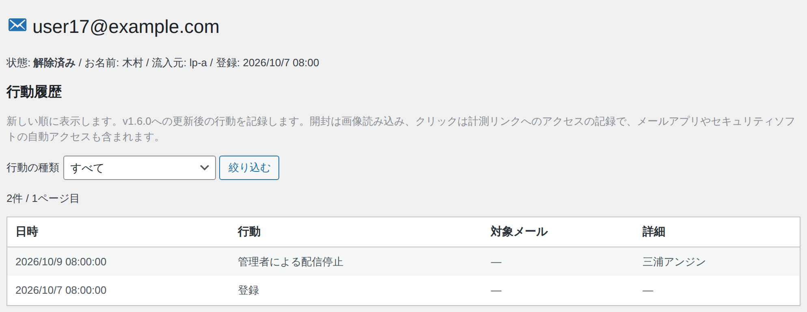

## 行動履歴の保存期間

行動履歴は、設定した期間を過ぎると自動で削除されます。

- 設定場所：「メール侍 → 設定 → 行動履歴の保存期間」
- 選択肢：90日・180日・365日・無期限
- 初期値：365日

期間を過ぎた履歴は、1時間ごとの定期処理で、少しずつ順番に削除されます。一度にすべて消えるわけではありません。「無期限」を選ぶと削除されません。

> **注意**
> 保存期間を短くすると、新しい期間より古い履歴は削除され、元に戻せません。期間を変える前に、必要な情報を控えておいてください。

保存期間による削除の対象は**行動履歴だけ**です。「配信記録・初回反応」と、それをもとにした開封率・クリック率などの集計は、保存期間に関係なく残ります。

# ダッシュボードで成果を見る

「メール侍 → ダッシュボード」で、シーケンスと期間（直近7日・30日・90日）を選ぶと、ステップメールの成果を確認できます。ここでの数字はステップメールのもので、メルマガの成果はメルマガ画面で確認します。

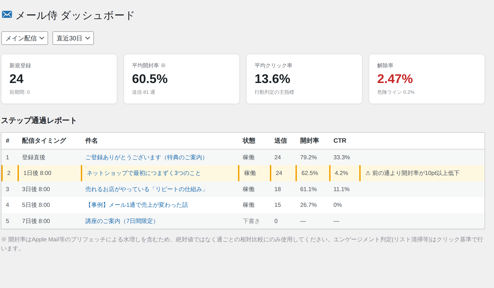

| 数字 | 意味 |
|---|---|
| 新規登録 | 選んだ期間に登録した人数（前の同じ長さの期間との比較つき） |
| 平均開封率 | 期間内に送ったステップメールのうち、開封を検知した通の割合 |
| 平均クリック率 | 期間内に送ったステップメールのうち、リンクがクリックされた通の割合 |
| 解除率 | 期間内の解除数を、送信通数で割った割合。0.2% を超えると赤く表示 |

これらの率は「配信記録・初回反応」をもとに、1通につき最大1回として数えます。

## ステップ通過レポート

ステップごとの送信数・開封率・クリック率（CTR）の一覧です。送信数が20通以上あり、前の通より開封率が10ポイント以上下がったステップには「⚠ 前の通より開封率が10pt以上低下」と表示されます。件名や送る時刻を見直す目安にしてください。

開封率は自動の画像読み込みで高めに出ることがあるため、反応の判断にはクリック率もあわせて使うのがおすすめです。

# 日々の運用とバウンス処理

## 購読者数と送信量

購読者数の上限はありません。バウンスを手動で処理する前提のため、数百件程度までが無理なく運用できる目安です。

1時間あたりに送れる通数は、次の2つで決まります。

- メール侍の「バッチサイズ」（5分ごとの最大通数。初期値50通＝1時間に最大600通）
- サーバーや送信サービスの送信上限

バッチサイズは、サーバー・送信サービスの上限を超えないように設定してください。上限は契約先によって違います。

## バウンスとは

**バウンス**とは、存在しないアドレスなどに送ったメールが届かず、「配信できませんでした」というエラーメールが戻ってくることです。

**未開封とバウンスは別物です。** 未開封は「届いたが、まだ開かれていない（または開封が計測できなかった）」状態です。バウンスは「そもそも届かなかった」状態です。

バウンスしたアドレスに送り続けると、受信側から送信者としての評価を下げられ、正しいアドレス宛てのメールまで迷惑メール扱いされやすくなります。

## 現在のバウンスの扱い

現在のメール侍本体には、バウンスを自動で検知したり、自動で配信を止めたりする機能はありません。次の手順で手動で処理してください。

1. 送信元アドレスの受信箱に、「Mail Delivery Failed」「Undelivered Mail」などの配信エラーメールが届いていないか、定期的に確認します。
2. エラーになったアドレスを「メール侍 → 購読者」で検索します。
3. 詳細画面で「このアドレスを配信停止する」を押します。

なお、バウンスを自動で処理するアドオン「Bounce Guard」を準備中です。現時点では提供していません。

## 手動の処理が負担になってきたら

リストが大きくなり、手動のバウンス処理が負担になってきた場合は、次のような選択肢があります。

- 配信エラーを確認する頻度と担当を決めて、定期作業にする
- バウンスの自動処理を備えた配信ツール（MailPoet など）への移行を検討する
- Bounce Guard の公開後に、導入を検討する

## 日々の点検リスト

- 設定画面の「Cron状態」が「● 正常」になっているか
- 設定画面に「直近の送信エラー」が出ていないか
- 送信元アドレスの受信箱に、配信エラーメールが届いていないか
- ダッシュボードで、解除率が急に上がっていないか、警告が出ているステップはないか
- メルマガを送った日は、「最近のメルマガ」の状態が「完了」になったか

# 配信が動かない・届かないとき

症状ごとに、確認する場所をまとめます。

## 登録できたのに、最初のメールが来ない

1. **SMTPの設定**：送信プラグインのテスト送信が届くか確認します。
2. **送信エラー**：「メール侍 → 設定」に「直近の送信エラー」が出ていないか確認します。
3. **1通目のステップ**：登録先のシーケンスに「0日 0時間後・丸めない」のステップがあり、状態が「稼働」になっているか確認します。登録フォーム画面に「登録直後に届くステップがまだありません」の警告が出ていないかも確認します。
4. **シーケンスの状態**：シーケンス画面で「■ 一時停止中」になっていないか確認します。
5. **迷惑メールフォルダ**：届いていても、迷惑メールに入っていることがあります。差出人とSPF・DKIM・DMARCも確認してください。
6. **購読者の詳細**：行動履歴に「送信処理成功」があれば、メール侍からの送り出しは成功しています。その場合は、送信プラグインや受信側（迷惑メール判定）を確認します。

## ステップメールが予定どおりに送られない

1. **配信タイミング**：「登録から○日○時間後」は登録日時が起点です。前のステップからの間隔ではありません。「配信時刻に丸める」を選んでいる場合は、その時刻まで送られません。
2. **ステップの状態**：「下書き」のステップは送られません。
3. **Cron状態**：設定画面で「● 停止の可能性」になっていないか確認します。WP-Cronはアクセスがないと動かないため、時刻どおりに送るにはサーバーcronを設定します。
4. **バッチサイズ**：一度に送る通数を超えた分は、次の5分後の処理に回ります。メルマガの送信中は、同じ枠を分け合います。
5. **送信失敗**：失敗した通は再試行されます。3回失敗すると送信をやめ、行動履歴に「送信失敗（再試行終了）」が残ります。

## メルマガが「送信待ち」のまま

1. **Cron状態**：配信処理が動いていなければ、送信は進みません。
2. **送信量**：配信対象が多いと、送り終わるまで時間がかかります。「送信状況」の通数が増えているか確認します。
3. **送信エラー**：「直近の送信エラー」と、「送信状況」の「（失敗 ○）」を確認します。
4. 送信中に解除した人の分は送られずに飛ばされ、未送信がなくなった時点で「完了」になります。

## 開封・クリックの履歴が表示されない

1. **トラッキング設定**：設定画面で、開封トラッキング・クリックトラッキングがONになっているか確認します。OFFのあいだに送ったメールは計測されません。
2. **更新前の行動**：v1.6.0 に更新する前の行動は、行動履歴には出ません。「配信記録・初回反応」を確認します。
3. **メールアプリの設定**：画像を表示しない設定では、開封は記録されません。クリックは記録されます。
4. **テスト送信**：テスト送信は計測しません。実際に登録したアドレスで確認してください。
5. **保存期間**：保存期間を過ぎた行動履歴は削除されています。
6. **絞り込み**：「行動の種類」で絞り込んでいないか確認します。

## 配信を解除した人が、もう一度登録した

同じシーケンスに同じアドレスで再登録すると、状態が「購読中」に戻り、行動履歴に「再登録」が記録されます。配信の予定は最初からやり直しにはなりません。解除したときにまだ予定日が来ていなかったステップのうち、再登録の時点でも予定日が先のものだけが、再び届きます。

## 登録フォームがコードのまま表示される

1. **貼り付けたブロック**：「ショートコード」ブロック（クラシックエディタでは本文）に貼っているか確認します。
2. **プラグインの有効化**：メール侍が「有効」になっているか確認します。
3. **表示している場所**：WordPressで公開したページで確認してください。HTMLファイルをパソコンで直接開いた場合は、ショートコードは動きません。
4. **ショートコードの書き間違い**：「登録フォーム」画面の「コピー」ボタンでコピーし直して貼り付けます。

## 送信エラーの表示について

送信に失敗したとき、メール侍は送信プラグインから受け取ったエラーの内容を、設定画面の「直近の送信エラー」とテスト送信の結果に表示します。表示される内容は送信プラグインやサーバーによって異なります。エラーが表示されたら、送信プラグインの設定（ホスト・ポート・ユーザー名・パスワード）と、差出人アドレスを確認してください。

# 付録

## 用語集

| 用語 | 意味 |
|---|---|
| シーケンス | ステップメールのまとまり。登録フォームの登録先、メルマガの配信リストになる |
| ステップ | シーケンスの中の1通1通のメール |
| ショートコード | `[mailsamurai_form ...]` のように書く短いコード。WordPressのページで機能に変わる |
| SMTP | メールを送信サーバー経由で送るための仕組み |
| SPF・DKIM・DMARC | 送信ドメインの認証。迷惑メール扱いを防ぐために設定する |
| WP-Cron | サイトへのアクセスをきっかけに動く、WordPressの定期処理 |
| サーバーcron | サーバーが決まった時刻に処理を実行する仕組み |
| キュー | 送信待ちのメールの行列。5分ごとに少しずつ送られる |
| バッチサイズ | 5分ごとの配信処理で送る最大通数 |
| バウンス | メールが届かず、配信エラーが戻ってくること |
| 開封率 | 送ったメールのうち、開封を検知した通の割合 |
| CTR（クリック率） | 送ったメールのうち、リンクがクリックされた通の割合 |

## 初期設定の一覧

| 項目 | 初期値 | 変更できる場所 |
|---|---|---|
| 送信元名 | サイトのタイトル | 設定 |
| 送信元アドレス | WordPressの管理者メールアドレス | 設定 |
| バッチサイズ | 50通 / 5分（1〜500） | 設定 |
| 開封トラッキング | ON | 設定 |
| クリックトラッキング | ON | 設定 |
| 行動履歴の保存期間 | 365日（90日・180日・365日・無期限） | 設定 |
| 新しいステップの状態 | 下書き（配信しない） | シーケンス |
| 登録フォームのボタンの色 | 緑（#16a34a） | 登録フォーム |

## 無効化と削除の違い

| 操作 | データ |
|---|---|
| 無効化 | 残ります。再び有効化すれば、そのまま使えます（無効化中は配信されません） |
| 削除 | 購読者・シーケンス・ステップ・配信記録・メルマガ・行動履歴・設定がすべて消えます。元に戻せません |

## 問い合わせ・不具合の報告

- 配布元・ソースコード：https://github.com/ecsamurai/mail-samurai
- 不具合の報告：GitHubの「Issues」からお寄せください。

メール侍（Mail Samurai）は、三浦アンジン（ecさむらい）が開発しています。
